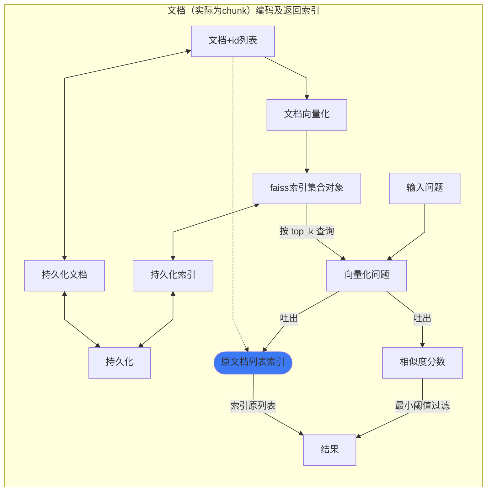

# 向量化存储及返回索引流程

---
snippet 配置:
	实线边(sb + Tab)：-->
	虚线边(tb + Tab)：-.->

	注解实线边：
		推荐(sxbz + Tab)：-- 注解 -->
		(sbz + Tab)：--> |注解|
		-- &nbsp;注解&nbsp; -->
	注解虚线边：
		推荐(tjbz + Tab)：-. 注解 .->
		(tbz + Tab)：-.-> |注解|
		-. &nbsp;注解&nbsp; .->

	换行（br）： 
---